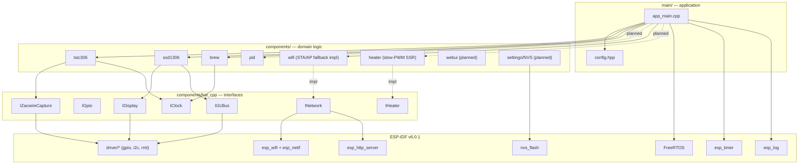
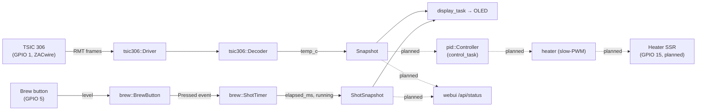

# ESPID-Coffee — Architecture

This document is the **single source of truth** for the firmware's
structure. It captures the system in its current shape and the
near-term planned subsystems so any contributor (or AI agent) can
locate themselves quickly. Keep it updated alongside every commit
that introduces, removes, or moves a subsystem.

> Companion: [`AGENTS.md`](AGENTS.md) — process / conventions / build &
> commit etiquette. Read both.

---

## 1. One-paragraph summary

ESPID-Coffee is an ESP-IDF v6.0.x firmware for the Rancilio Silvia
espresso machine, replacing the Arduino-framework
[CleverCoffee](https://github.com/rancilio-pid/clevercoffee). It runs
on an ESP32-S3 (N16R8). Modern C++17, no exceptions/RTTI,
`Result<T>`/`Status` for error propagation, **strict bisectability**,
TDD via GoogleTest on the ESP-IDF Linux target for all pure-logic
components, and atomic Conventional-Commits commits.

---

## 2. Target hardware

| Item              | Detail                                                    |
| ----------------- | --------------------------------------------------------- |
| MCU               | ESP32-S3 (Sparkle XH-S3E N16R8 — 16 MB flash, 8 MB octal PSRAM) |
| Toolchain         | ESP-IDF v6.0.1 (`/Users/facosta/git/espressif/esp-idf-v6.0.1`) |
| Serial port       | `/dev/cu.usbmodem5ABA0676261`                             |
| Temperature       | TSIC 306, ZACwire 1-wire on **GPIO 1**                    |
| Display           | SSD1306 0.96″ 128×64 OLED, I²C addr 0x3C @ 400 kHz, **SDA=GPIO 8 / SCL=GPIO 9**, rotated 180° |
| Brew button       | Active-low, HW-debounced (RC + Schmitt) on **GPIO 5**, internal pull-up enabled as fallback |
| Steam switch      | Latching mode-select input on **GPIO 4**, active-high, internal pull-down |
| Heater SSR        | Slow-PWM (1 s period) on **GPIO 47**, active-high        |
| Pump neutral SSR  | Always-on pump enable on **GPIO 15**, active-high        |
| Pump PSM triac    | Phase-control gate on **GPIO 17** + mains zero-cross opto on **GPIO 18** (50 Hz / 100 Hz half-cycles) |
| Valve relay       | 3-way solenoid on **GPIO 16**, active-high               |
| Pressure sensor   | Honeywell ABP2, I2C addr 0x28 (shared bus SDA=8 / SCL=9) |
| Load cell (scale) | Dual HX711 (data **GPIO 7 / GPIO 10**, shared clock **GPIO 21**); disabled until bench calibration |

Pin allocation rationale: GPIO 0/3/45/46 are strapping; 19/20 = USB-JTAG;
26-32 = octal PSRAM/flash on N16R8; 33-37 = JTAG. We avoid all of them.

---

## 3. Source tree

```
ESPID-Coffee/
├── CMakeLists.txt                # top-level; patches managed nixy4/u8g2
├── partitions.csv                # OTA layout (factory + ota_0 + ota_1 + nvs + spiffs)
├── sdkconfig{,.defaults}         # ESP-IDF config
├── main/
│   ├── CMakeLists.txt
│   ├── app_main.cpp              # entry: spawns sensor / display / button tasks
│   ├── deep_sleep.{hpp,cpp}      # standby: output latches, wake sources, wake reason
│   ├── timekeeping.{hpp,cpp}     # TZ + SNTP wall clock
│   └── config.hpp                # compile-time defaults (namespace espid::config)
├── main/data/                    # LittleFS web-UI assets (index.html, style.css, app.js)
├── components/
│   ├── hal_cpp/                  # header-only HAL contracts + Result<T>/Status
│   │   └── include/hal_cpp/
│   │       ├── result.hpp
│   │       ├── i_system_clock.hpp
│   │       ├── i_gpio.hpp
│   │       ├── i_i2c_bus.hpp
│   │       ├── i_zacwire_capture.hpp
│   │       ├── i_display.hpp
│   │       ├── i_heater.hpp      # slow-PWM SSR HAL contract
│   │       └── i_network.hpp     # Wi-Fi HAL contract
│   ├── tsic306/                  # RMT-based ZACwire driver + pure decoder
│   ├── ssd1306/                  # U8g2-backed IDisplay implementation
│   ├── wifi/                     # esp_wifi INetwork impl (STA + AP fallback)
│   ├── pid/                      # header-only PID + heater phase, over-temp guard, telemetry helpers
│   ├── abp2/                     # ABP2 pressure sensor driver + decoder
│   ├── heater/                   # slow-PWM SSR IHeater implementation
│   ├── valve/                    # 3-way solenoid GPIO driver
│   ├── pump/                     # PSM phase-control pump (ZC ISR) + PsmCore + refill sequencer
│   ├── scale/                    # dual-HX711 driver + ScaleCore (pure logic)
│   ├── hawkbit/                  # HawkBit DDI OTA client
│   ├── brew/                     # debounced brew button + shot timer (header-only)
│   ├── ui/                       # OLED status/prompt selection (header-only)
│   └── power/                    # standby timer, daily wake, sleep planning (header-only)
├── host_tests/                   # GoogleTest harness, ESP-IDF Linux target
│   ├── CMakeLists.txt
│   ├── test_tsic306.cpp
│   ├── test_pid.cpp
│   ├── test_pump.cpp
│   ├── test_scale.cpp
│   └── test_brew.cpp
└── scripts/
    └── bisect_verify.sh          # walks N commits, runs build+host-tests on each
```

---

## 4. Layering



Rules:

- `components/hal_cpp/` is **header-only** and contains only interfaces.
  Never put ESP-IDF symbols in HAL headers (they must compile against
  the Linux target for unit tests).
- Concrete drivers depend on HAL interfaces, never on each other.
- Pure-logic components (`pid`, `brew`, `tsic306` decoder half) have **zero**
  ESP-IDF includes — they are exercised by `host_tests/` on Linux.
- `main/` owns wiring (tasks, snapshots, lifetime), not domain logic.

---

## 5. Runtime — tasks, cores, priorities

| Task          | Core | Priority | Stack  | Period   | Owner                              |
| ------------- | ---- | -------- | ------ | -------- | ---------------------------------- |
| `sensor`      |  1   |    5     | 4096 B | event    | TSIC capture + decode → snapshot   |
| `control`     |  1   |    5     | 4096 B | 200 ms   | PID loop → heater; mode-aware setpoint + over-temp guard |
| `pump`        |  1   |    5     | 4096 B | 200 ms   | Startup fill guard + pressure-PID pump power (PSM via ISR) |
| `pressure`    |  1   |    4     | 4096 B | 200 ms   | ABP2 polling + pressure snapshot   |
| `display`     |  1   |    4     | 4096 B | 200 ms   | OLED render from snapshot          |
| `button`      |  1   |    3     | 3072 B |  10 ms   | Brew button debounce → shot timer + valve |
| `steam`       |  1   |    3     | 3072 B |  10 ms   | Steam switch debounce → `g_steam_active` |
| `scale`       |  1   |    3     | 4096 B | 100 ms   | Dual HX711 read → weight (disabled by default) |
| `mqtt`        |  1   |    2     | 6144 B | event    | Telemetry publish (TLS, optional HA discovery) |
| `hawkbit`     |  0   |    1     | 8192 B | 5 min    | HawkBit DDI OTA poll               |
| `power`       |  0   |    2     | 4096 B | 1 s      | Standby countdown → park tasks → deep sleep |
| `heartbeat`   | idle | (main)   |  —     | 5000 ms  | `app_main`, proof-of-life log      |
| `wifi-evt`    |  0   | esp-wifi | (IDF)  | event    | esp_event task (esp_wifi)          |
| `httpd`       |  0   |    5     | 8192 B | event    | esp_http_server worker (web UI + provisioning) |

All values come from `main/config.hpp`. Treat that file as the only
place where stack/prio/core/period literals live in firmware code.

---

## 6. Shared state — snapshot pattern

Producers publish into struct-of-`std::atomic<>` snapshots; consumers
read with `memory_order_relaxed` for the payload after observing a
release-published `valid` flag. **No queues, no mutexes** for the
hot path — values are 32-bit naturally aligned on ESP32-S3.

Current shared state (defined in `main/app_main.cpp`):

```cpp
struct Snapshot {        // produced by sensor_task
    std::atomic<float>         temp_c;
    std::atomic<std::uint16_t> raw;
    std::atomic<std::uint64_t> timestamp_ms;
    std::atomic<bool>          valid;   // release/acquire barrier
};

struct ShotSnapshot {    // produced by button_task
    std::atomic<std::uint32_t> elapsed_ms;
    std::atomic<bool>          running;
};

struct PressureSnapshot { // produced by pressure_task
    std::atomic<float>         pressure_bar, pressure_psi, sensor_temp_c;
    std::atomic<std::uint32_t> pressure_counts;
    std::atomic<bool>          stale, valid;
};

struct RuntimeControlSettings { // NVS-shadowed, mutated by web-UI handler
    std::atomic<float> pid_kp, pid_tn_s, pid_tv_s;
    std::atomic<float> brew_setpoint_c, steam_setpoint_c;
    std::atomic<float> brew_kp, brew_tn_s, brew_tv_s, brew_trailing_s,
                       brew_pulse_s;
    std::atomic<float> pump_kp, pump_ki, pump_kd;
};
```

Standalone control/coordination flags (all `std::atomic`):
`g_control_duty_pct`, `g_pump_power_pct`, `g_weight_g`, `g_steam_active`
(steam switch → control_task setpoint select), `g_emergency_stop`
(over-temp latch), `g_fill_complete` / `g_fill_ok` (startup-fill
handshake gating the heater), `g_mqtt_connected`. The shared OLED/ABP2
I2C bus is guarded by `g_i2c_bus_mutex` (a real mutex — the only lock in
the design).

Two further snapshots feed telemetry: `g_control` (heater phase,
setpoint, error, slope, P/I/D split and the gains in force, written by
control_task every step) and `g_shot_summary` (per-shot dip/overshoot/
settling metrics, published once per shot behind a `seq` counter that
mqtt_task re-checks to reject a torn read).

MQTT publish cadence is not fixed: `pid::TelemetryPolicy` picks it from
the heater phase — 1 s during the first 10 min after boot, 500 ms while
brewing or trailing, 1 s for steam or any excursion off setpoint, and a
10 s heartbeat once settled. Each record carries enough state to replay
the loop offline; `shot_summary` closes each shot, and `brew_start` /
`brew_stop` / `steam_on` / `steam_off` / `refill_start` / `refill_stop`
mark the mode edges. A `status` record goes out on every heartbeat
(`kHeartbeatPeriodMs`, 5 s) for dashboards: the machine state the OLED
shows (`machine_state` / `machine_state_id`), firmware version, the key
live values, free heap, Wi-Fi RSSI, why this boot happened (`wake_id`)
and the standby countdown (`sleep_in_s`). A `sleep` record is the last
word before deep sleep, with the timer wake epoch (`-1`: switch only).

Post-steam handling. `pid::OverTempGuard` (in control_task) keeps the steam
over-temperature limits in force after the steam switch goes off, until the
boiler has cooled below the brew stop threshold minus a margin; it publishes
that cool-down as `g_steam_cooldown`. A brew-switch press during the
cool-down is not a shot: button_task raises `g_refill_switch` instead, leaves
the valve closed, and pump_task runs `pump::RefillSequencer`, pumping gently
into the boiler until pressure confirms it is hydraulically full (or a
timeout, or the switch is released). Results land in `g_refill` behind
start/stop sequence counters for mqtt_task; `refill_stop` reports pump
half-cycles fired and the temperature drop, the two handles for estimating
how much water went back in.

Standby. The machine stays mains-powered; standby is ESP32-S3 deep sleep.
power_task counts down `power::InactivityTimer` (default 90 min): a steam
switch change or a settings save restarts it; a shot, a refill, the
startup fill or an OTA download hold it. On expiry it raises
`g_sleep_pending`, which parks the other tasks -- control_task forces the
heater to 0 %, mqtt_task sends the `sleep` record, display_task shows a
goodbye screen and puts the panel to sleep (charge pump off) -- then calls
`enter_deep_sleep()`. Every output is latched at its inactive level
through the sleep (heater SSR, valve, pump gate, TSIC supply); the two
latching switches are armed as wake sources (`power::select_wake_pins`:
off switches on ext1 "any high", one left on via ext0 when it turns off);
an RTC timer wakes the machine at the daily wake time when SNTP has set
the clock since power-on. Every wake is a full reboot through the normal
power-on path; `begin_boot()` drops the latches first and classifies the
wake. Without a 32 kHz crystal the sleep clock drifts a few percent, so a
long sleep is split by `power::plan_sleep()`: early timer wakes only join
Wi-Fi, resync SNTP and sleep again (`run_clock_resync()`), and the last
leg of <= 2 min is slept straight to the target.

Every record also carries numeric mirrors of its string fields (`rec`
for the record type, `phase_id` for the heater phase). The collector
(Hono → Kafka → Telegraf → TimescaleDB) parses JSON with the numeric-only
field rule, so undeclared string fields never reach the database; the
strings stay for human and MQTT consumers, the codes are what persist.

---

## 7. Data flow



---

## 8. Display states

```mermaid
stateDiagram-v2
    [*] --> Splash
    Splash --> Idle: 2 s elapsed
    Idle --> Brewing: brew button pressed (timer.start)
    Brewing --> Idle: brew button pressed (timer.stop)
    Idle --> Steam: steam switch on
    Steam --> Idle: steam switch off

    note right of Splash : "ESPID-Coffee"<br/>"v0.0.4"
    note right of Idle : Big temperature<br/>Footer: shot time + "SP:" brew setpoint<br/>Wi-Fi badge in header
    note right of Brewing : Big shot timer<br/>Footer: pressure + temperature<br/>Wi-Fi badge in header
    note right of Steam : Big temperature<br/>Footer: "STEAM" + "ST:" steam setpoint
```

Steam is a footer/label overlay on the Idle screen, not a separate
full-screen state: while `g_steam_active` is set the footer shows
`STEAM` and the steam setpoint (`ST:`) instead of the shot time and
brew setpoint (`SP:`). The brewing screen still takes precedence if a
shot is pulled.

---

## 9. Error model

All driver / init APIs return `espid::hal_cpp::Result<T>` (value-or-error)
or `Status` (void-or-error). Both are `[[nodiscard]]`. Errors are
finite — see `Error` enum in
[`components/hal_cpp/include/hal_cpp/result.hpp`](components/hal_cpp/include/hal_cpp/result.hpp).
Add new variants there before introducing them at call sites.

Convention: non-critical subsystems log a warning and continue
headless on init failure (e.g. OLED). Critical subsystems halt with
an `ESP_LOGE` + busy-loop (e.g. TSIC driver).

---

## 10. Configuration

[`main/config.hpp`](main/config.hpp) is the **single boot-time
configuration namespace** (`espid::config::*`). Everything is
`constexpr` — no macros, no globals. Sections in current use: `tsic`,
`oled`, `brew`, `steam`, `pid`, `heater`, `valve`, `pump`, `pressure`,
`net`, `mqtt`, `hawkbit`. `scale` is wired but gated off
(`scale::kEnabled == false`) until bench calibration.

Runtime-mutable parameters (idle and brew-phase heater PID gains, brew
trailing time and heat pulse, brew/steam setpoints, pump PID gains,
Wi-Fi credentials, MQTT endpoint, HawkBit
server/token) are shadowed from NVS at boot and overridden live by the
embedded web UI; `config::` remains the compile-time fallback.

---

## 11. Build, flash, test

Day-to-day commands (source ESP-IDF once per shell, then use `idf.py`
normally):

```sh
# Prepare shell (once per terminal session)
get_idf

# Build firmware
idf.py build

# Flash + monitor
idf.py -p /dev/cu.usbmodem5ABA0676261 flash monitor

# Host unit tests (Linux target)
cmake -S host_tests -B host_tests/build && cmake --build host_tests/build \
  && ctest --test-dir host_tests/build --output-on-failure

# Bisect-green sanity check across the last N commits
scripts/bisect_verify.sh -n 5
```

If `get_idf` alias is unavailable in your shell:

```sh
. ~/git/espressif/esp-idf-v6.0.1/export.sh
```

---

## 12. Roadmap

| Phase | Subsystem                            | Status   | Notes |
| ----- | ------------------------------------ | -------- | ----- |
| 0     | ESP-IDF scaffold + partition table   | ✅ done  | `44fc917` |
| 1     | HAL contracts + `Result<T>`/`Status` | ✅ done  | `100b673`, `5df06cc` |
| 2a    | TSIC 306 decoder (host tests)        | ✅ done  | `aa3a9fc` |
| 2b    | TSIC 306 RMT driver + sensor_task    | ✅ done  | `968e86f`, `42480fb`, `8d8834e` |
| 2c    | SSD1306 OLED + display_task          | ✅ done  | `b019316`, `fc88319`, `df4f6ce` |
| 2c'   | Rotation option (180°)               | ✅ done  | `6fe45f1`, `524b1e2` |
| 2d-1  | PID controller (host tests)          | ✅ done  | `27f1e91` |
| 2d-2  | Brew button + shot timer (host tests)| ✅ done  | `b398854` |
| 2d-3  | Brew button wiring + OLED shot view  | ✅ done  | `653fe47` |
| 2e    | `main/config.hpp` (single SoT)       | ✅ done  | `d30bb14` |
| 2f    | Boot splash                          | ✅ done  | `074797b` |
| 3a    | **`INetwork` HAL contract**          | ✅ done  | `ede75a0` |
| 3b    | Wi-Fi STA + AP-fallback impl         | ✅ done  | `d8a3191` |
| 3c    | Web-form credential capture (AP fallback → NVS) | ✅ done | |
| 3d    | `app_main` wiring + OLED Wi-Fi glyph | ✅ done  |     |
| 4a    | `IHeater` HAL + slow-PWM SSR driver  | ✅ done  | |
| 4b    | `control_task` running `pid::Controller` | ✅ done | mode-aware setpoint + over-temp guard |
| 4c    | **Steam mode** (switch → setpoint, steam over-temp guard, OLED label) | ✅ done | this change |
| 5a    | Embedded web UI (LittleFS static assets + `esp_http_server`) | ✅ done | |
| 5b    | `/api/status` + config/provisioning form handlers | ✅ done |     |
| 6     | NVS-backed runtime settings (PID, setpoints, pump, MQTT) | ✅ done | `app_cfg` namespace |
| 7     | MQTT bridge (TLS, optional Home Assistant discovery) | ✅ done | |
| 8     | Pump PSM (triac + ZC ISR) + 3-way valve control | ✅ done | fill guard + pressure PID |
| 9     | Dual-HX711 scale (driver + `ScaleCore`) | 🚧 driver done | disabled pending calibration |
| 10    | Safety over-temp latch + HawkBit A/B OTA | 🚧 partial | emergency-stop + DDI poll live; watchdog TBD |
| 11    | Standby: deep sleep after inactivity + daily SNTP-timed wake | ✅ done | `power` component, `/power` settings |

Explicitly deferred: TLS for the local web UI, Bluetooth.

---

## 13. Glossary

- **Bisect-green** — every commit on `main` builds AND passes host
  tests in isolation. Enforced by `scripts/bisect_verify.sh`.
- **Snapshot** — struct-of-atomics published by a producer task and
  read lock-free by consumers; `valid` flag uses release/acquire as
  the publication barrier.
- **Header-only component** — `idf_component_register(INCLUDE_DIRS …)`
  with no SRCS. Consumed via `REQUIRES`.
- **Slow-PWM** — software-toggled output with a period in the
  hundreds-of-ms to seconds range, suitable for solid-state relays
  driving resistive loads.
